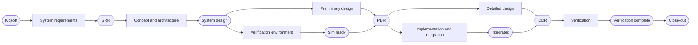
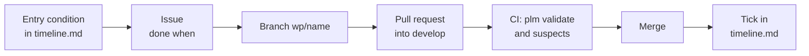

# The Hangar development process

Hangar develops an aviation product with a team of AI agents along the V-model. The owner (a person) sets the goal and takes every decision in owner meetings. The chief engineer (the main Claude Code session) plans and coordinates; discipline agents do the engineering and independent reviewers check it. The whole engineering record (requirements, analyses, decisions, interfaces, CAD, software, tests, reviews and meeting records) lives in this repository as traceable items managed with the PLM tool `plm`. GitHub carries the work around the items: issues, pull requests, CI and baselines. The shift lets the chief engineer work unattended until the owner is needed. This document describes the process; the binding rules are in `CLAUDE.md` (all agents) and the skill `.claude/skills/chief-engineer/` (the chief engineer only).

## 1. Roles

| Role | Who | Does |
|---|---|---|
| Owner | the person | Sets goal and constraints, holds the owner meetings, decides, merges baselines to `main` |
| Chief engineer | main Claude Code session, or the shift | Plans, briefs one agent at a time, checks the work, merges work packages, prepares meetings, keeps the four files of §8 |
| Discipline agents | `.claude/agents/` | `systems-engineer`, `safety-engineer`, `sizing-engineer`, `structures-engineer`, `avionics-engineer`, `flight-control-engineer`, `autonomy-engineer`, `software-engineer`, `simulation-engineer`, `verification-engineer`: own and write their items |
| Independent reviewers | `.claude/agents/` | `requirements-reviewer`, `analysis-reviewer`, `software-reviewer`, and `safety-engineer` as safety reviewer: write `review` items, close findings |

The kickoff trims the team to the project. Every item has exactly one owner agent; only the owner edits it.

## 2. Lifecycle



Phases end in **milestones** (rounded) or **gates** (hexagons). Each has entry conditions and a budget in 5-hour usage windows, the resource that limits the work. The kickoff tailors the phases; `project-plan.md` holds their content and the gate criteria, `timeline.md` their budgets and state.

## 3. The product record

* **Items** are folders with an `item.yaml`, nested as the product structure: the system item at the top, subsystems inside it, and in each item its `requirements/`, `analyses/`, `decisions/`, `interfaces/`, `tests/`, `reviews/`, `meetings/`. Files belonging to an item (scripts, reports, CAD, code) are its artifacts.
* **Types:** requirement, assembly, part, software, analysis, decision, interface, hazard, test-case, test-run, review, meeting. Project types and fields are defined in `plm.yaml` and `schemas/`.
* **Traceability:** derived requirements `satisfies` their parents, designs `satisfies` requirements, analyses and decisions `implements` the requirements they rest on, test cases `verifies` requirements. When an item changes, `plm` marks the links to it **suspect** until its owner checks and confirms them.
* **Numbers** come only from committed scripts in analysis items; `run` reproduces `result`.
* **Status:** `draft` → `in-review` → `approved`. Items become `approved` at a gate go; the gate's state of `main` is the **baseline**, tagged `<gate>-baseline`.

## 4. Work



* The chief engineer takes an open entry condition of the active milestone and closes it with one or more **work packages**: an issue with a *done when* line, a branch `wp/<name>`, commits after every step, a pull request into `develop`, the peer review it needs, green CI, merge.
* Agents propose before they write, reuse existing open-source software (recorded as decisions and pinned software items), verify their own work, and report in at most 150 words. Detail goes into the items.
* Work that closes no entry condition goes to the backlog as an issue. Done is final: a ticked topic is reopened only by a `major` finding or an owner decision.

## 5. Owner meetings

The owner decides in meetings (skill `.claude/skills/meeting/`): **kickoff**, **gates** (SRR, PDR, CDR), **milestone reviews**, **decision meetings**, **re-plans**, **status meetings** and the **close-out**.

1. **Prepare:** the chief engineer creates the `MTG-` item, writes `pack.md` (at most two pages: summary, facts generated by `plm`, each decision with options, consequences and a recommendation), opens an issue labelled `meeting`, and stops.
2. **Hold:** the owner runs `/meeting <MTG-ID>`. The chief engineer presents point by point, answers questions from the items or asks the owning agent, and puts each decision to the owner. Questions that need new work become actions.
3. **Record:** decisions become `DEC-` items, actions become issues, the MTG item gets `minutes.md` and the verdict. A gate go approves the items in scope and opens the baseline pull request `develop` → `main`.

Between meetings, a question that blocks only part of the work is a `needs-owner` issue; the owner answers in a comment and the chief engineer records the answer as an item.

## 6. Reviews

* **Peer review** in the pull request, for a work package that changes an interface or another owner's items.
* **Independent review** at every milestone and gate by the reviewers, each as a `review` item with the reviewed commit and one finding per issue.
* Findings are `major` (blocks the milestone or gate, gets a second round), `minor` or `remark` (fixed when cheap, otherwise a backlog issue). Only the reviewer closes a finding.

## 7. The shift

The shift (`.claude/shift/`) runs the chief engineer unattended in cycles, as a systemd user service, in its own git worktree on `develop`. Each cycle is a fresh session doing one work package. It stops for the owner when a meeting is prepared, when it is blocked, or when nothing is left; the owner gets a GitHub notification. The runner measures progress in usage windows against the budget the owner set and stops the shift when a milestone stalls or overruns. A guard hook blocks owner actions (anything on `main`, baseline tags, approvals, repository settings, forced or deleting git operations). Details: `.claude/shift/README.md`.

## 8. The chief engineer's files

| File | Holds | Updated |
|---|---|---|
| `handover.md` | The start of every session: the system item, active topics and their next step, open pull requests, blockers, the owner's standing directions | at every merge and shift cycle |
| `timeline.md` | The overall picture (every phase, milestone and gate with budget, windows used and state) and the active milestone (entry conditions, active topics, coming meetings) | at every merge and shift cycle |
| `project-plan.md` | Goal, given decisions and resources, team, phases, gate criteria | with the owner's agreement in a meeting |
| `risks.md` | The risk register, presented at every gate and status meeting | when a risk changes, at the latest for each meeting |

All four hold the current state only; history is in git. Everything else the chief engineer needs is an item, an issue, or generated by `plm`: decisions are `DEC-` items, the backlog and open questions are issues, counts come from `plm` at the gate.

When the method itself gets in the way, the chief engineer opens an issue on the Hangar repository, so the template improves from every project.

## 9. GitHub

| Feature | Use |
|---|---|
| Issues and forms | Work packages, backlog entries, owner decisions (`needs-owner`), meetings (`meeting`) |
| Labels | `type:*`, `owner:<agent>`, `needs-owner`, `meeting`, `blocked`, `gate-condition`, `won't do` |
| Milestones | The project's milestones and gates; closed at the meeting that accepts them |
| Branches | `main`: owner-approved baselines only; `develop`: integration; `wp/<name>`: work packages |
| Pull requests | One per work package into `develop`; one baseline PR `develop` → `main` per gate, merged by the owner |
| Actions | `plm validate` and `plm suspects` on every push and pull request (`.github/workflows/plm.yml`) |
| CODEOWNERS, protection | The owner reviews changes to the method and tool configuration; `main` is protected (`scripts/setup.sh --protect`) |
| Tags | `<gate>-baseline` at each gate go |

Agents use `gh` with the credentials of the account they run under. The shift should run as its own Linux user with its own GitHub account (write access, no admin rights, `main` protected): it then cannot read the owner's files, merge baselines or change settings (`.claude/shift/README.md`).

## 10. Tools

| Tool | Used for | Version |
|---|---|---|
| Claude Code | Owner sessions, chief engineer, agents, skills | current |
| Claude Agent SDK (Python) | The shift | pinned in `.claude/shift/requirements.txt` |
| Claude Remote Control | Owner sessions from the Claude app on the host (`systemd/remote.service`) | current |
| `plm` ([PLM](https://github.com/florian-bridges/PLM)) | Items, links, suspects, impact, coverage, test runs | pinned in `.plm-version` |
| git and Git LFS | Version control, large binaries | — |
| GitHub, `gh`, GitHub Actions | Issues, pull requests, milestones, CI, baselines | — |
| Python with `uv` | Analysis scripts, the shift | Python ≥ 3.11 |
| Node.js | Runs `plm` | ≥ 22.18 |
| systemd user services | Running the shift and Remote Control on the host | — |
| ntfy.sh (optional) | Phone push from the shift | — |

Engineering tools (CAD, simulators, flight control software) are chosen per project by `decision` items and pinned as `software` items.

## 11. Repository

```
CLAUDE.md          rules for all agents
PROCESS.md         this document
handover.md        start of every session
timeline.md        overall picture and active milestone
project-plan.md    goal, team, phases, gate criteria
risks.md           risk register
plm.yaml, schemas/ item types and fields
.plm-version       plm version used
.claude/agents/    the team
.claude/skills/    chief-engineer rules, meeting procedure and agendas
.claude/shift/     unattended run
.github/           issue forms, PR template, CI, CODEOWNERS
scripts/setup.sh   one-time project setup
<system item>/     created at the kickoff: conops.md, requirements, subsystems, …
```

## 12. Starting and updating a project

1. On GitHub: **Use this template** → new repository. Clone it on the host.
2. `scripts/setup.sh --protect`.
3. Start Claude Code in the repository and run `/meeting kickoff`.
4. Optionally install the shift (`.claude/shift/README.md`) and start it after the kickoff.

To take later improvements of the template: `git remote add hangar https://github.com/florian-bridges/hangar && git fetch hangar && git merge hangar/main`. This merges cleanly as long as project specifics stay out of the generic files (`CLAUDE.md`, `PROCESS.md`, `.claude/`); put them into the project plan and the items. The chief engineer's four files are skeletons in the template and the project's own afterwards: keep the project's version on a merge conflict. Lessons learned for the method go to the Hangar issues, for the tool to the PLM issues.
